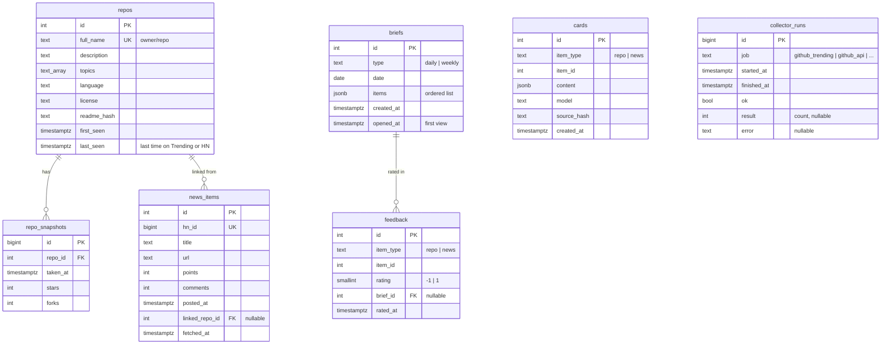

# Tech Radar — Data Model

**Source of truth:** [`backend/app/models.py`](../../backend/app/models.py) and the migrations in [`backend/alembic/versions/`](../../backend/alembic/versions/). This page explains the model; if it disagrees with the code, the code wins and this page must be fixed in the same commit.

## Entity diagram

`cards` and `feedback` point at items polymorphically (`item_type` + `item_id`), so they have no foreign key to `repos` / `news_items`.

## Tables

| Table | Meaning | Key rules |
| --- | --- | --- |
| `repos` | A candidate repo: seen on GitHub Trending or linked from HN | Unique `full_name`. Tracked (snapshotted) while `last_seen` is within `track_days`. |
| `repo_snapshots` | Stars and forks at one point in time | One row per tracked repo per GitHub API run. Momentum (stars/day, 7-day gain) is computed from these. Index on `(repo_id, taken_at)`. |
| `news_items` | One Hacker News story | Upsert by `hn_id`; points/comments refreshed each run. |
| `cards` | LLM-written card for an item | `content` = what_it_is, problem_it_solves, whats_special, worth_trying, source_kind (readme/article/title), source_url, limited. Reused while `source_hash` (sha256 of source kind + text) matches. Index on `(item_type, item_id)`. |
| `briefs` | A built daily brief or weekly leaderboard | Unique `(type, date)`. `items` holds the ordered item refs plus the signals shown; each entry has `section` (top/repos/news), `item_type` (`repo`/`news`), `item_id` and the signals at build time (title, url, stars, stars_per_day, points, comments, points_per_hour, matched_topics, score…); read by scoring's repeat penalty and by prune. `opened_at` set once on first view. Weekly leaderboards (spec 006): `type = weekly`, `date` = the week's Monday, entries carry `rank`, `stars_gained`, `since`; they don't count for the repeat penalty or the stats. |
| `feedback` | A 👍/👎 on an item in a brief | `rating` is -1 or 1; one row per (brief, item), replaced on change, deleted when cleared. Feeds the 👎 penalty in scoring. |
| `llm_usage` | One LLM call (migration 0003, REQ-CRD-004) | Tokens in/out, model, purpose, item, ok/error. The monthly sum of tokens is checked against `llm.monthly_token_cap` before every call. Index on `at`. |
| `collector_runs` | One run of a background job, scheduled or from the CLI (REQ-COL-007, migration 0002) | Written by `run_job()` via `app/runs.py`; a failure to write is logged and never fails the job. Index on `(job, started_at)`; `/api/collectors/status` reads the latest per job. |

## Retention

Weekly `prune` job (`app/collectors/prune.py`, REQ-COL-006):

- HN stories posted more than `retention_days` (30) ago are deleted. Spec 005 adds "unless a brief references them".
- Snapshots of repos no longer tracked (`last_seen` older than `track_days`) are deleted; repo rows stay. Spec 005 adds "and never reached a brief" (Q-013).
- Cards, briefs, feedback and `collector_runs` are kept.

## Changing the schema

1. Edit `models.py`.
2. `uv run alembic revision --autogenerate -m "<what>"`, then review the generated file.
3. `uv run alembic upgrade head`.
4. Update this page (diagram + table) in the same commit.
