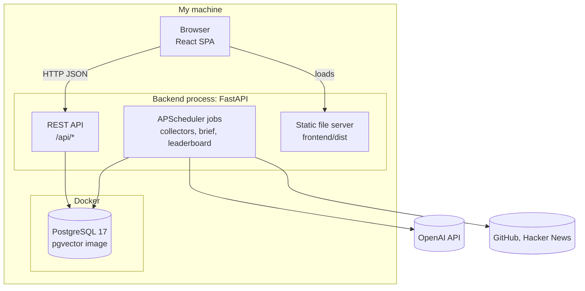
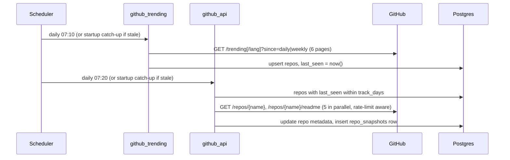
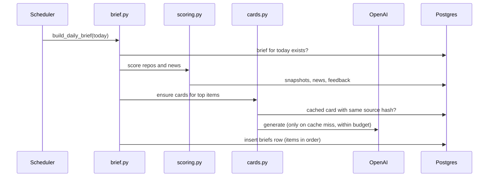

# Tech Radar — Architecture Overview

A lightweight [arc42](https://arc42.org)-style overview. Diagrams follow the [C4 model](https://c4model.com) and are written in Mermaid. Decisions and their reasons are in [decisions/](decisions/).

## 1. Context

## 2. Constraints

- Single user, runs on my Windows laptop; the machine may be asleep at scheduled times.
- Cheap to run: LLM spend capped monthly; free APIs only.
- Must be easy to move to a small server later without code changes.

## 3. Containers

| Container | Tech | Responsibility |
| --- | --- | --- |
| Frontend | React, Vite, TypeScript, Tailwind, TanStack Query, React Router | Today (status + brief), Rising repos, News, Leaderboard, Card, Stats pages; rating buttons |
| Backend | Python 3.12+, FastAPI, APScheduler, SQLAlchemy async, httpx | API, scheduled collectors, scoring, card generation, brief building; serves the built frontend |
| Database | PostgreSQL 17 (pgvector image), Alembic migrations | All state; see [data-model.md](data-model.md) |
| LLM | OpenAI Responses API via `openai` SDK | Writes structured cards; settings in `config.yaml` → `llm` |

## 4. Backend components

| Module | Role |
| --- | --- |
| `app/main.py` | App factory, lifespan (starts/stops scheduler), mounts frontend |
| `app/config.py` | Loads `.env` (secrets) and `config.yaml` (settings) into typed models |
| `app/db.py`, `app/models.py` | Async engine/session; ORM models (schema source of truth) |
| `app/scheduler.py` | Registers jobs and their intervals; `run_job()` logs each run and isolates failures |
| `app/collectors/__init__.py` | Shared HTTP client (`make_client`) and retry policy (`transient_retry`) |
| `app/collectors/github_trending.py` | Scrapes GitHub Trending pages → upserts candidate repos *(spec 001, built)* |
| `app/collectors/github_api.py` | Tracked repos → metadata, README hash, star snapshot; rate-limit aware *(spec 001, built)* |
| `app/collectors/hacker_news.py` | HN front page + popular stories (Algolia) → `news_items`; GitHub-linked stories become repo candidates *(spec 002, built)* |
| `app/collectors/prune.py` | Weekly prune: stories > 30 days, snapshots of untracked repos *(spec 002, built)* |
| `app/news_stats.py` | Pure points/hour (age floored at 1 h) *(spec 002, built)* |
| `app/scoring.py` | Interest-topic matching (`TopicMatcher`, weak `~terms`), boosts, `score_item()` with repeat and 👎 penalties, `load_signals()` *(spec 003, built)* |
| `app/news_feed.py` | Recent stories + points/hour + topics + AI/dev flag + score, shared by API and CLI *(spec 003, built)* |
| `app/momentum.py` | Pure stars/day and stars-gained functions over snapshots *(spec 001, built)* |
| `app/cli.py` | Run a collector once (recorded like a scheduled run) / print momentum: `python -m app.cli ...` |
| `app/runs.py` | Collector run log: `record_run()`, `last_runs()` *(spec 008, built)* |
| `app/repo_stats.py` | Tracked repos + latest stars + stars/day + topics + score, shared by API and CLI *(spec 008, 003)* |

Frontend: `src/pages/` (Today, Repos, News, Leaderboard, Stats, Card), `src/components/CollectorStatus.tsx` (job status panel), `src/api/client.ts` (fetch helper + types).
| `app/scoring.py` | Pure scoring functions *(spec 003)* |
| `app/llm.py` | The only place that calls the LLM |
| `app/cards.py` | Card prompt, cache and budget check *(spec 004)* |
| `app/brief.py` | Builds daily brief and weekly leaderboard *(spec 005, 006)* |
| `app/api/` | Route modules under `/api` |

## 5. Runtime flows

**Collection (daily, Q-014):** Hacker News 07:00 → GitHub Trending 07:10 → star snapshots 07:20 (last, so new candidates get a snapshot); the brief (spec 005) comes after. Each job fetches → normalizes → upserts into Postgres → logs counts; errors are retried with backoff and logged; other jobs are unaffected. A slot missed while the laptop slept still runs on wake (12 h grace). On startup, `schedule_catch_up()` runs a job once only if its last success in `collector_runs` is older than 20 h (prune: 7 days).

**Morning brief (07:00, or on startup if missed):**

**Hacker News (daily 07:00, spec 002):** two Algolia queries (front page; stories > 100 points from the last 26 h) → merged by HN id → GitHub-linked stories upsert repo candidates (`last_seen = now`, so the API job snapshots them) → stories upserted by `hn_id`. **Prune** (Mondays 07:40): deletes stories older than 30 days and snapshots of repos not seen for `track_days`.

**Scoring (spec 003, on every read):** repo score = stars/day × topic boost × penalties; news score = points/hour × topic boost × penalties for AI/dev stories only. Topic boost = 1.5 per matched interest topic (cap 3.0); penalties: ×0.3 if briefed within the cooldown, ×0.7 per topic shared with a recent 👎 (floor 0.2); both read from `briefs`/`feedback` and are no-ops until spec 005. All weights and term lists live in `config.yaml` (`interests`, `scoring`).

**Browsing news (spec 002):** News page → `GET /api/news?days=7` (stories + linked repo name, points/hour via `news_stats.py`).

**Browsing repos (spec 008):** Rising repos page → `GET /api/repos` (tracked repos + last 48 h of snapshots → stars/day via `momentum.py`) and `GET /api/collectors/status` (latest `collector_runs` row per job + scheduler's next run); both refetch every minute; search/filter/sort run in the browser.

**Reading:** browser loads the SPA → `GET /api/briefs/today` → first view sets `opened_at` → 👍/👎 posts to `/api/feedback`.

## 6. Deployment

- **Dev:** `docker compose up -d db`; `uv run fastapi dev app/main.py` (:8000); `npm run dev` (:5173, proxies `/api`).
- **Daily use:** `npm run build`, then `uv run fastapi run app/main.py`; one URL, `http://localhost:8000`.
- **One-off runs:** `uv run python -m app.cli collect trending|github|hn`, `prune`, `momentum --top 20`.
- **Later:** same containers on a small server; add a Dockerfile for the backend then.

## 7. Cross-cutting concepts

- **Config:** secrets in `.env`, everything else in `config.yaml`, both validated by Pydantic at startup.
- **Time:** timestamps stored as `timestamptz`; schedules in the configured timezone.
- **Resilience:** collectors are idempotent upserts, so re-running a job is always safe.
- **Cost control:** LLM only for top items, cached by source hash, monthly budget cap.
- **Logging:** standard `logging`, one line per job run with counts and duration.

## 8. Quality checks

- Backend: `ruff check`, `ruff format`, `pytest` (scoring logic is unit-tested on fixed data).
- Frontend: `npm run typecheck`.
- Docs: `python scripts/status.py --check` keeps `STATUS.md` in sync with specs.
