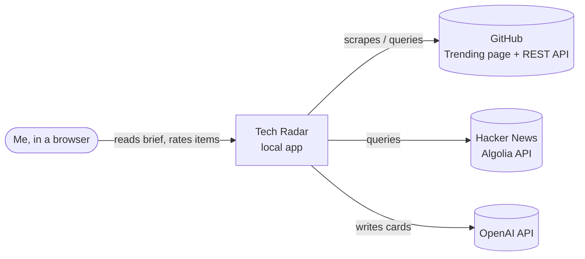
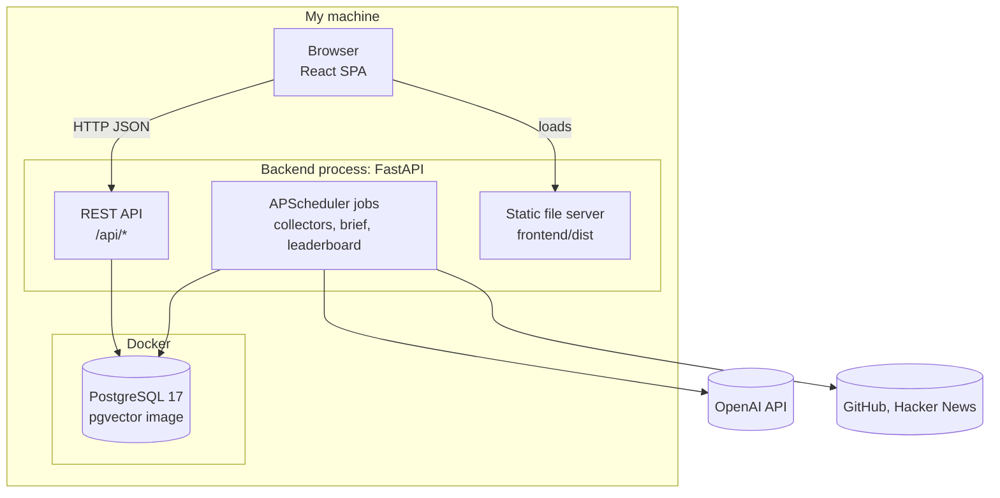
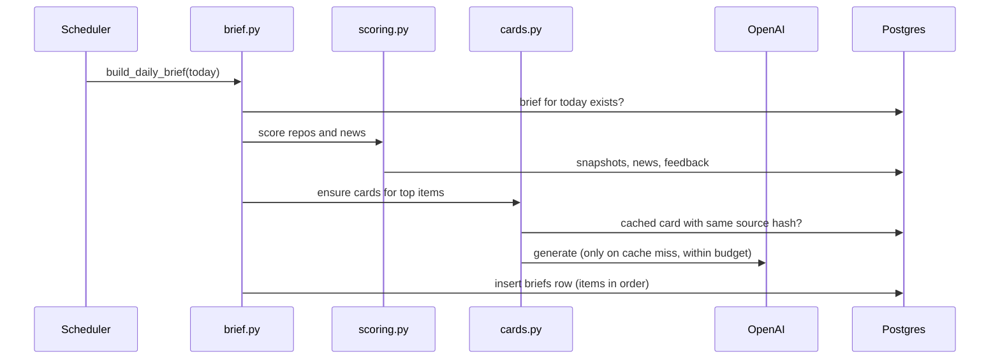

# Tech Radar — Architecture Overview

A lightweight [arc42](https://arc42.org)-style overview. Diagrams follow the [C4 model](https://c4model.com) and are written in Mermaid. Decisions and their reasons are in [decisions/](decisions/).

## 1. Context

## 2. Constraints

- Single user, runs on my Windows laptop; the machine may be asleep at scheduled times.
- Cheap to run: LLM spend capped monthly; free APIs only.
- Must be easy to move to a small server later without code changes.

## 3. Containers

| Container | Tech | Responsibility |
| --- | --- | --- |
| Frontend | React, Vite, TypeScript, Tailwind, TanStack Query, React Router | Today, Leaderboard, Card, Stats pages; rating buttons |
| Backend | Python 3.12+, FastAPI, APScheduler, SQLAlchemy async, httpx | API, scheduled collectors, scoring, card generation, brief building; serves the built frontend |
| Database | PostgreSQL 17 (pgvector image), Alembic migrations | All state; see [data-model.md](data-model.md) |
| LLM | OpenAI Responses API via `openai` SDK | Writes structured cards; settings in `config.yaml` → `llm` |

## 4. Backend components

| Module | Role |
| --- | --- |
| `app/main.py` | App factory, lifespan (starts/stops scheduler), mounts frontend |
| `app/config.py` | Loads `.env` (secrets) and `config.yaml` (settings) into typed models |
| `app/db.py`, `app/models.py` | Async engine/session; ORM models (schema source of truth) |
| `app/scheduler.py` | Registers jobs and their intervals |
| `app/collectors/` | One module per source; each is an independent job *(spec 001, 002)* |
| `app/scoring.py` | Pure scoring functions *(spec 003)* |
| `app/llm.py` | The only place that calls the LLM |
| `app/cards.py` | Card prompt, cache and budget check *(spec 004)* |
| `app/brief.py` | Builds daily brief and weekly leaderboard *(spec 005, 006)* |
| `app/api/` | Route modules under `/api` |

## 5. Runtime flows

**Collection (every few hours, per source):** job fetches → normalizes → upserts into Postgres → logs counts. Errors are retried with backoff and logged; other jobs are unaffected.

**Morning brief (07:00, or on startup if missed):**

**Reading:** browser loads the SPA → `GET /api/briefs/today` → first view sets `opened_at` → 👍/👎 posts to `/api/feedback`.

## 6. Deployment

- **Dev:** `docker compose up -d db`; `uv run fastapi dev app/main.py` (:8000); `npm run dev` (:5173, proxies `/api`).
- **Daily use:** `npm run build`, then `uv run fastapi run app/main.py`; one URL, `http://localhost:8000`.
- **Later:** same containers on a small server; add a Dockerfile for the backend then.

## 7. Cross-cutting concepts

- **Config:** secrets in `.env`, everything else in `config.yaml`, both validated by Pydantic at startup.
- **Time:** timestamps stored as `timestamptz`; schedules in the configured timezone.
- **Resilience:** collectors are idempotent upserts, so re-running a job is always safe.
- **Cost control:** LLM only for top items, cached by source hash, monthly budget cap.
- **Logging:** standard `logging`, one line per job run with counts and duration.

## 8. Quality checks

- Backend: `ruff check`, `ruff format`, `pytest` (scoring logic is unit-tested on fixed data).
- Frontend: `npm run typecheck`.
- Docs: `python scripts/status.py --check` keeps `STATUS.md` in sync with specs.
